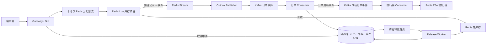

# Go 高并发秒杀交易系统

基于 Go、Gin、Redis、Kafka 与 MySQL 实现的秒杀交易后端。系统将高频抢购请求中的库存预占放在 Redis 原子脚本中完成，将订单持久化、排行榜更新与取消回补放到独立的异步服务处理，从而降低热点商品对 MySQL 的直接写入压力。

> 这是一个用于学习、演示和验证交易一致性的单机 Docker Compose 项目。Redis、Kafka 与 MySQL 均为单节点部署；它不宣称跨 Redis/MySQL 的 Exactly Once，也没有实现生产级身份认证或 Redis 高可用集群。

## 核心能力

- **热点库存原子预占**：Redis Lua 在一次原子执行中校验库存、记录预占事实、写入 Redis Stream，并扣减热库存，库存耗尽时立即拒绝。
- **可靠异步下单**：Redis Stream 作为库存预占后的本地事件记录；独立 Publisher 将事件投递到 Kafka，Kafka 确认前不确认 Stream 消息，进程重启后可继续投递未完成事件。
- **幂等订单持久化**：Kafka Consumer 在 MySQL 事务内创建订单、扣减持久库存、记录已处理事件；重复事件不会重复建单或重复扣减。
- **订单状态与取消回补**：订单状态机仲裁支付、取消等并发操作。取消任务持久化并由独立 Worker 执行，通过稳定幂等标识完成 Redis 或 Redis 与 MySQL 的库存回补。
- **流量治理与可观测性**：本地和 Redis 分层令牌桶在库存操作前拦截流量；Prometheus、Grafana、Jaeger 和 JSON 日志用于观测接口、消息、数据库与库存回补链路。

## 系统架构



## 秒杀如何执行

秒杀接口只负责“能否预占一件库存”，不会等待订单写入 MySQL 或支付完成。

```text
1. 客户端请求 POST /api/v1/seckill。
2. Gateway 执行本地令牌桶和 Redis 全局、商品、用户维度限流。
3. Gateway 本地生成 order_id、reservation_id 与 event_id。
4. Redis Lua 在一个原子单元中：
   - 检查库存 Key、参数和 Reservation 状态；
   - 库存不足时直接拒绝；
   - 写入 Reservation Hash，保存订单、用户、商品、数量等不可变事实；
   - 写入 Redis Stream；
   - 扣减 Redis 热库存。
5. Gateway 返回 202 Accepted 与 order_id：它表示库存预占和事件记录成功，
   不表示订单已经最终写入 MySQL。
6. Outbox Publisher 读取 Redis Stream，向 Kafka 发布相同 event_id 的订单事件。
   仅在 Kafka 确认后，才确认 Redis Stream 消息；发布结果不确定时保留待处理消息并重试。
7. Order Consumer 在一个 MySQL 事务中完成订单写入、持久库存扣减、
   生命周期记录和事件去重记录；成功后再提交 Kafka 消费进度。
8. 客户端使用 GET /api/v1/orders/:id 查询最终订单状态。
```

### 为什么不会超卖

Redis 对同一实例中的 Lua 脚本串行执行。库存判断与 `DECR` 在同一脚本内完成：

```text
库存 > 0  → 写入预占与事件 → 库存减一
库存 <= 0 → 直接拒绝，不写预占、不产生订单事件
```

因此多个请求竞争同一库存 Key 时，只有库存数量范围内的请求能完成预占。订单 Consumer 若发现持久化失败、重复订单或库存事实冲突，会走带幂等标识的补偿，避免 Redis 库存长期被占用。

## 订单取消与库存回补

取消不进入秒杀热点链路。其目标是：订单只有在库存回补已经完成后，才变成 `cancelled`。

```text
1. 取消请求写入订单生命周期：created → cancelling。
2. 同一个 MySQL 事务创建库存释放任务；任务包含 reservation_id、稳定 release_id、
   尝试次数、下次执行时间、租约及错误信息。
3. Release Worker 领取未完成或租约过期的任务。
4. Worker 调用 Redis Lua：校验 Reservation 事实与 release_id，
   在同一脚本中将热库存加回，并将 Reservation 标记为 released。
5. Worker 根据 persistent_inventory_state 决定 MySQL 是否也需要回补：
   - applied：订单 Consumer 曾扣减 MySQL，回补 Redis 和 MySQL；
   - not_applied：提前取消发生在持久库存扣减前，仅回补 Redis。
6. 回补完成后，Worker 将订单状态更新为 cancelled。
```

同一预占只允许一个释放任务；Redis 回补使用稳定的 `release_id`。即使 Worker 在 Redis 成功后、更新 MySQL 前崩溃，重试也只会识别为同一次已完成 Redis 回补，再继续完成 MySQL 状态收敛，不会重复加库存。

## 消息可靠性与幂等

| 场景 | 处理方式 |
|---|---|
| Gateway 在 Redis 预占后崩溃 | 事件已在同一 Lua 脚本写入 Redis Stream，Publisher 可继续投递。 |
| Kafka 已接收但 Publisher 未收到确认 | 保留原 `event_id` 重投；Consumer 以幂等方式处理。 |
| Publisher 在 Kafka 成功后、Stream 确认前崩溃 | Pending Stream 消息可被重新领取，再次发送同一业务事件。 |
| Kafka 重复投递 | MySQL 已处理事件记录与订单唯一约束阻止重复订单、重复扣库存。 |
| Consumer 建单失败 | 记录失败事实并以 Reservation 为单位补偿 Redis 库存。 |
| Worker 崩溃 | 任务租约过期后由其他 Worker 重新领取；重试采用指数退避。 |

## 订单状态

```text
created ──支付成功──> succeeded
   │
   └──取消申请──> cancelling ──库存回补完成──> cancelled
```

支付只允许 `created → succeeded`，取消只允许 `created → cancelling`。数据库条件更新和行锁保证两者竞争时只有一个状态迁移能够成功；重复同类请求可安全重试，终态冲突会返回明确结果。

## 服务与组件职责

| 服务/组件 | 职责 |
|---|---|
| `gateway` | Gin HTTP 接入、限流、生成业务 ID、调用 Redis 预占、查询订单、开发环境取消入口。 |
| Redis | 热库存 String、预占 Hash、Stream 事件记录、限流状态、排行榜 ZSet。 |
| `outbox-publisher` | 读取 Redis Stream，可靠投递订单事件到 Kafka。 |
| Kafka | 解耦库存预占与订单持久化，缓冲突发流量。 |
| `order-consumer` | 幂等消费订单事件，在 MySQL 事务中创建订单并扣减持久库存。 |
| MySQL | 活动、商品、订单、生命周期、已处理事件、库存释放任务和持久库存的最终事实。 |
| `release-worker` | 以任务租约、重试和 Lua 幂等回补完成取消后的库存释放。 |
| `rank-consumer` | 消费持久化成功订单事件，更新 Redis 排行榜。 |

## 快速开始

需要 Docker Desktop、Docker Compose 和 Go 工具链。

```powershell
# 启动基础设施与服务
make up

# 执行数据库迁移
make migrate

# 单元测试、竞态检测与集成测试
make test
make test-race
make test-integration
```

常用地址：

| 地址 | 用途 |
|---|---|
| `http://localhost:8080/healthz` | Gateway 健康检查 |
| `http://localhost:8080/readyz` | Gateway 就绪检查 |
| `http://localhost:8080/metrics` | Gateway Prometheus 指标 |
| `http://localhost:3000` | Grafana |
| `http://localhost:16686` | Jaeger |

## API 概览

| 方法 | 路径 | 用途 |
|---|---|---|
| `POST` | `/api/v1/admin/product` | 创建商品 |
| `POST` | `/api/v1/admin/activity` | 创建秒杀活动 |
| `POST` | `/api/v1/admin/activity/:id/warmup` | 将可售库存预热到 Redis |
| `POST` | `/api/v1/seckill` | 提交秒杀预占请求，返回 `202 Accepted` 与订单号 |
| `GET` | `/api/v1/orders/:id` | 查询订单状态 |
| `GET` | `/api/v1/users/:user_id/orders` | 查询用户订单 |

取消接口只在开发环境同时设置 `ORDER_CANCEL_API_ENABLED=true` 时开放，并要求 `X-Development-User-ID`。这只是测试身份，不是生产鉴权。

## 已知边界

- 当前 Redis、Kafka、MySQL 以单节点 Docker Compose 运行；Redis 开启 AOF，但未配置 Sentinel 或 Cluster。
- Redis 全部数据丢失而 Reservation Hash 缺失时，系统不会盲目回补或重建库存，而是保留释放任务并等待人工对账。
- 系统提供至少一次事件投递与幂等消费，不提供跨 Redis、Kafka、MySQL 的 Exactly Once。
- 当前没有 JWT、Session 等生产级认证；不能信任请求体中的 `user_id` 作为真实用户身份。
- 同一用户在 Redis 热路径的提前限购仍待认证接入后实现；目前由 MySQL `(activity_id, user_id)` 唯一约束在异步落库阶段兜底，并对无效预占执行补偿。

## 代码阅读

从 [代码阅读指南](docs/code-reading-guide.md) 开始；更详细的架构和一致性说明位于 [docs](docs/)。
