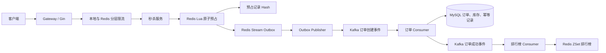
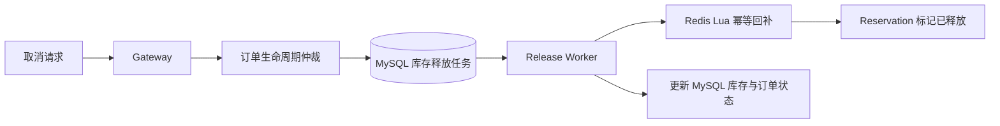

# 源码阅读顺序与模块地图

这份指南面向第一次阅读本项目的人。目标是先读懂一条秒杀请求如何变成订单，再理解取消回补、限流、排行榜和可观测性等配套模块。不要按目录从上到下逐个打开文件；那样会先遇到很多配置、指标和测试细节，反而看不清主流程。

## 1. 先建立全局认识

### 可执行服务入口

| 服务 | 入口文件 | 作用 |
| --- | --- | --- |
| HTTP Gateway | [`cmd/gateway/main.go`](../cmd/gateway/main.go) | 启动对外 HTTP 服务。所有秒杀、查询、模拟支付和受开关保护的取消请求从这里进入。 |
| 订单 Consumer | [`cmd/order-consumer/main.go`](../cmd/order-consumer/main.go) | 启动 Kafka 订单事件消费者，将异步事件持久化为 MySQL 订单。 |
| Outbox Publisher | [`cmd/outbox-publisher/main.go`](../cmd/outbox-publisher/main.go) | 启动 Redis Stream 到 Kafka 的可靠发布器。 |
| 排行榜 Consumer | [`cmd/rank-consumer/main.go`](../cmd/rank-consumer/main.go) | 消费订单成功事件，更新 Redis 排行榜。 |
| 库存释放 Worker | [`cmd/release-worker/main.go`](../cmd/release-worker/main.go) | 领取取消后的库存释放任务，执行幂等回补。 |

这些入口本身很短。它们统一调用 [`internal/bootstrap/service.go`](../internal/bootstrap/service.go)，该文件负责读取配置、捕获退出信号并等待服务正常停止。

### 默认主服务路径

默认库存路径是 `redis_lua_only`：热点秒杀请求不等待 Etcd 锁。Etcd 代码保留为可选 A/B 实验路径。

### 取消与回补路径

取消 API 默认不对生产环境开放；只有开发环境且打开配置开关时才注册。这里的重点是理解状态机和任务恢复机制，而不是把它当成已接入真实支付平台的订单系统。

## 2. 推荐阅读顺序

### 第一轮：30 分钟读通正常下单

按下面顺序阅读，每一步只问一个问题。

1. [`README.md`](../README.md)：服务如何启动、有哪些 API 和依赖。
2. [`docker-compose.yml`](../docker-compose.yml)：有哪些容器，哪个可执行程序在运行。
3. [`cmd/gateway/main.go`](../cmd/gateway/main.go) → [`internal/bootstrap/service.go`](../internal/bootstrap/service.go)：Gateway 是怎样启动和退出的。
4. [`internal/gateway/gateway.go`](../internal/gateway/gateway.go)：路由从 HTTP 请求如何进入业务服务。
5. [`internal/seckill/async.go`](../internal/seckill/async.go)：`PurchaseAsync` 如何生成三个稳定 ID 并调用库存预占。
6. [`internal/inventory/redis_store.go`](../internal/inventory/redis_store.go)：`Reserve` 与 `reserveScript` 如何在一次 Redis Lua 执行中校验库存、记录预占、写 Stream 和扣减库存。
7. [`internal/outbox/publisher.go`](../internal/outbox/publisher.go)：Stream 消息如何在 Kafka 确认后才被确认消费；失败消息如何恢复。
8. [`internal/kafka/order_event.go`](../internal/kafka/order_event.go) → [`internal/kafka/producer.go`](../internal/kafka/producer.go)：异步事件的数据结构和 Kafka 投递封装。
9. [`internal/order/consumer.go`](../internal/order/consumer.go)：Kafka 事件如何通过一个 MySQL 事务变成订单、库存变更和已处理事件记录。

读到这里，你就已经能解释项目最重要的一条链路：**网关只负责同步预占；订单落库由后续异步消费者完成。**

### 第二轮：取消、支付和库存回补

1. [`internal/seckill/lifecycle.go`](../internal/seckill/lifecycle.go)：支付与取消如何用订单状态机仲裁。
2. [`internal/release/tasks.go`](../internal/release/tasks.go)：取消如何创建持久任务，Worker 如何领取、重试、完成任务。
3. 回到 [`internal/inventory/redis_store.go`](../internal/inventory/redis_store.go)：阅读 `Release` 和对应 Lua 脚本，理解为什么同一 `release_id` 不会重复加 Redis 库存。
4. [`scripts/mysql/003_m9a_order_lifecycle.sql`](../scripts/mysql/003_m9a_order_lifecycle.sql) 至 [`scripts/mysql/006_m9_final_release_tasks.sql`](../scripts/mysql/006_m9_final_release_tasks.sql)：用表结构核对状态、预占事实、MySQL 库存是否已扣减和释放任务如何持久化。
5. [`tests/integration/m9_final_release_test.go`](../tests/integration/m9_final_release_test.go)：用测试回看重复取消、支付取消竞争、租约接管和失败恢复。

### 第三轮：再读支撑能力

建议顺序是限流 → 排行榜 → 指标与追踪 → 健康检查 → 可选 Etcd 锁 → 故障注入与日志。它们都很重要，但不决定一笔订单的基本生成过程。

## 3. 核心业务目录地图

### `internal/gateway/`：HTTP 接入层

| 文件 | 负责什么 | 阅读重点 |
| --- | --- | --- |
| [`gateway.go`](../internal/gateway/gateway.go) | 组装 MySQL、Redis、限流器、库存 Store、订单服务，注册 Gin 路由。 | `Run`、`registerRoutes`、秒杀请求处理函数。 |
| [`errors.go`](../internal/gateway/errors.go) | 将领域错误转为统一 HTTP 状态码和响应。 | 库存不足、限流、状态冲突如何返回。 |
| [`metrics.go`](../internal/gateway/metrics.go) | Gateway 的秒杀成功、库存耗尽等指标。 | 仅用于观测，不承载业务判断。 |

### `internal/seckill/`：秒杀和订单查询业务编排

| 文件 | 负责什么 | 阅读重点 |
| --- | --- | --- |
| [`async.go`](../internal/seckill/async.go) | 秒杀业务主入口。 | `PurchaseAsync`：校验活动、生成 `reservation_id`/`event_id`/`order_id`、调用 `Reserve`。 |
| [`mysql_service.go`](../internal/seckill/mysql_service.go) | 商品和活动创建、库存预热、订单查询与列表查询。 | 初始化和查询读模型。 |
| [`lifecycle.go`](../internal/seckill/lifecycle.go) | 模拟支付、取消意图和状态迁移。 | 只允许规定状态间的转换；取消会创建释放任务。 |
| [`mysql_service_test.go`](../internal/seckill/mysql_service_test.go) | 秒杀服务的输入或金额校验测试。 | 看业务输入边界。 |

### `internal/inventory/`：Redis 热库存、预占记录和 Lua 原子操作

| 文件 | 负责什么 | 阅读重点 |
| --- | --- | --- |
| [`redis_store.go`](../internal/inventory/redis_store.go) | 库存存储接口及 Redis 实现。 | `Reservation`、`Reserve`、`Compensate`、`Release` 和三段 Lua 脚本。 |
| [`keys.go`](../internal/inventory/keys.go) | 库存、预占记录、Stream 和排行榜 Redis Key 规则。 | Key 的 Hash Tag 使相关 Key 可以放在同一 Redis Cluster 槽位。 |
| [`metrics.go`](../internal/inventory/metrics.go) | Redis 库存操作耗时与结果指标。 | 观测辅助。 |
| [`redis_store_test.go`](../internal/inventory/redis_store_test.go) | Redis Key 和存储实现相关单测。 | 核对 Key 设计约束。 |

理解这一目录时，请记住 `Reservation` 是整条链路的事实载体：同一份业务身份会进入 Redis Hash、Redis Stream、Kafka 消息和 MySQL。

### `internal/outbox/`：Redis Stream 到 Kafka 的可靠交接

| 文件 | 负责什么 | 阅读重点 |
| --- | --- | --- |
| [`runner.go`](../internal/outbox/runner.go) | 初始化 Redis、Kafka Producer、指标并启动 Publisher。 | 服务装配。 |
| [`publisher.go`](../internal/outbox/publisher.go) | 读取 Stream、恢复未确认消息、投递 Kafka、确认 Stream。 | `claimPending`、`readNew`、`publishMessages`。只有 Kafka 确认后才推进 Stream 消费进度。 |
| [`publisher_integration_test.go`](../internal/outbox/publisher_integration_test.go) | Publisher 的集成测试。 | ACK 前不确认、崩溃恢复、预占缺失时不盲投等故障场景。 |

### `internal/kafka/`：事件模型和 Producer 封装

| 文件 | 负责什么 | 阅读重点 |
| --- | --- | --- |
| [`order_event.go`](../internal/kafka/order_event.go) | 订单创建、订单成功等事件结构。 | 哪些字段从 Redis Stream 传到 Consumer。 |
| [`producer.go`](../internal/kafka/producer.go) | Kafka Producer 接口和 Franz Kafka 实现。 | 投递确认、失败重试和 Producer 关闭。 |

### `internal/order/`：Kafka 消费、订单持久化和幂等

| 文件 | 负责什么 | 阅读重点 |
| --- | --- | --- |
| [`consumer.go`](../internal/order/consumer.go) | 消费订单创建事件并执行 MySQL 事务。 | `RunConsumer`、`ProcessResult`、`persist`、`lockLifecycle`、`compensateAndMark`。 |
| [`id.go`](../internal/order/id.go) | 生成时间有序、跨 Gateway 节点不冲突的订单 ID。 | `IDGenerator.Next`；订单号不编码用户 ID，用户 ID 单独存入订单记录。 |
| [`metrics.go`](../internal/order/metrics.go) | Consumer 结果、延迟和事务耗时指标。 | 用于定位 Consumer 或数据库瓶颈。 |
| [`lifecycle_testhook_integration.go`](../internal/order/lifecycle_testhook_integration.go) | 仅集成测试使用的提前取消意图入口。 | 不属于正式对外 API。 |
| [`id_test.go`](../internal/order/id_test.go) | ID 生成唯一性与节点隔离测试。 | 多 Gateway 实例的 ID 冲突防护。 |

### `internal/release/`：取消后的可靠库存释放

| 文件 | 负责什么 | 阅读重点 |
| --- | --- | --- |
| [`runner.go`](../internal/release/runner.go) | 初始化 MySQL、Redis 并启动库存释放 Worker。 | Worker 生命周期。 |
| [`tasks.go`](../internal/release/tasks.go) | 创建、领取、执行、重试和完成释放任务。 | `CreateForLifecycle`、`claim`、`process`、`complete`、`retry`。 |

该模块通过持久任务和租约避免“进程重启后取消任务消失”。它根据持久库存状态判断 MySQL 库存是否已经实际扣减，因此不会无条件同时加 Redis 和 MySQL。

### `internal/limiter/`：分层限流

| 文件 | 负责什么 | 阅读重点 |
| --- | --- | --- |
| [`local.go`](../internal/limiter/local.go) | 进程内令牌桶。 | `LocalBucket.Allow`；用于最靠近 Gateway 的快速削峰。 |
| [`redis.go`](../internal/limiter/redis.go) | Redis 共享令牌桶和 Lua 脚本。 | 多 Gateway 实例之间共享限流状态。 |
| [`service.go`](../internal/limiter/service.go) | 串联本地、全局、商品和用户维度限流。 | `Service.Allow` 的检查顺序。 |
| [`keys.go`](../internal/limiter/keys.go) | 限流相关 Key 生成。 | 系统、商品、用户三个维度。 |
| [`metrics.go`](../internal/limiter/metrics.go) | 限流拒绝和等待指标。 | 观测辅助。 |
| [`local_test.go`](../internal/limiter/local_test.go) | 本地令牌桶单测。 | 令牌补充和拒绝边界。 |
| [`keys_test.go`](../internal/limiter/keys_test.go) | 限流 Key 单测。 | Key 隔离。 |

### `internal/ranking/`：订单成功排行榜

| 文件 | 负责什么 | 阅读重点 |
| --- | --- | --- |
| [`consumer.go`](../internal/ranking/consumer.go) | 消费订单成功事件并更新 Redis ZSet。 | `Apply`；同一个订单重复事件不会重复累计。 |

### `internal/lock/`：可选的 Etcd 锁实验路径

| 文件 | 负责什么 | 阅读重点 |
| --- | --- | --- |
| [`locker.go`](../internal/lock/locker.go) | 锁接口和空实现。 | 默认是空实现，表示 `redis_lua_only`。 |
| [`etcd.go`](../internal/lock/etcd.go) | 官方 Etcd `concurrency.Mutex` 的适配封装。 | 只用于 Etcd 与 Lua A/B 对照。 |
| [`metrics.go`](../internal/lock/metrics.go) | 锁等待、获取失败等指标。 | 分析 Etcd 路径性能。 |

### 基础设施与横切能力

| 文件 | 负责什么 |
| --- | --- |
| [`internal/config/config.go`](../internal/config/config.go) | 所有环境变量、默认值和配置校验。 |
| [`internal/config/config_test.go`](../internal/config/config_test.go) | 配置解析与校验测试。 |
| [`internal/database/mysql.go`](../internal/database/mysql.go) | MySQL 连接池创建、连接数和 Ping 健康检查。 |
| [`internal/platform/httpserver/server.go`](../internal/platform/httpserver/server.go) | HTTP Server 启动与优雅关闭。 |
| [`internal/health/health.go`](../internal/health/health.go) | MySQL、Redis、Kafka、Etcd 等依赖健康检查。 |
| [`internal/health/health_test.go`](../internal/health/health_test.go) | 健康检查测试。 |
| [`internal/observability/tracing.go`](../internal/observability/tracing.go) | OpenTelemetry 追踪初始化和 Metrics HTTP 服务。 |
| [`internal/fault/delay.go`](../internal/fault/delay.go) | 仅开发/测试环境的受控延迟注入。 |
| [`internal/fault/delay_test.go`](../internal/fault/delay_test.go) | 延迟注入测试。 |
| [`internal/logs/loki.go`](../internal/logs/loki.go) | Loki 日志查询适配。 |
| [`internal/logs/loki_test.go`](../internal/logs/loki_test.go) | Loki 查询适配测试。 |

### `pkg/`：通用复用包

| 文件 | 负责什么 |
| --- | --- |
| [`pkg/apperror/error.go`](../pkg/apperror/error.go) | 领域错误类型和分类。 |
| [`pkg/apperror/error_test.go`](../pkg/apperror/error_test.go) | 领域错误测试。 |
| [`pkg/response/response.go`](../pkg/response/response.go) | 统一 JSON 响应格式。 |
| [`pkg/logger/logger.go`](../pkg/logger/logger.go) | `slog` 日志初始化。 |
| [`pkg/logger/loki.go`](../pkg/logger/loki.go) | 异步写 Loki 的日志 Handler。 |
| [`pkg/logger/ring.go`](../pkg/logger/ring.go) | 进程内最近日志 Ring Buffer。 |
| [`pkg/logger/ring_test.go`](../pkg/logger/ring_test.go) | Ring Buffer 测试。 |
| [`pkg/middleware/request_id.go`](../pkg/middleware/request_id.go) | 注入或透传请求 ID。 |
| [`pkg/middleware/tracing.go`](../pkg/middleware/tracing.go) | W3C Trace Context 处理。 |
| [`pkg/middleware/logging.go`](../pkg/middleware/logging.go) | 访问日志中间件。 |
| [`pkg/middleware/observability.go`](../pkg/middleware/observability.go) | HTTP 指标和追踪中间件。 |
| [`pkg/middleware/request_id_test.go`](../pkg/middleware/request_id_test.go) | 请求 ID 中间件测试。 |
| [`pkg/middleware/tracing_test.go`](../pkg/middleware/tracing_test.go) | 追踪中间件测试。 |

## 4. 数据库迁移：先从表结构理解事实如何落盘

| 文件 | 作用 |
| --- | --- |
| [`001-bootstrap.sql`](../scripts/mysql/001-bootstrap.sql) | 初始化迁移环境。 |
| [`002_m1_schema.sql`](../scripts/mysql/002_m1_schema.sql) | 商品、活动、库存、订单、已处理事件等基础表。 |
| [`003_m9a_order_lifecycle.sql`](../scripts/mysql/003_m9a_order_lifecycle.sql) | 订单生命周期仲裁表。 |
| [`004_m9a_lifecycle_reservation.sql`](../scripts/mysql/004_m9a_lifecycle_reservation.sql) | 将预占和事件事实补入生命周期表。 |
| [`005_m9b_outbox_inventory_state.sql`](../scripts/mysql/005_m9b_outbox_inventory_state.sql) | 记录 MySQL 持久库存是否已实际扣减。 |
| [`006_m9_final_release_tasks.sql`](../scripts/mysql/006_m9_final_release_tasks.sql) | 持久化库存释放任务、租约和重试字段。 |
| [`run-migrations.sh`](../scripts/mysql/run-migrations.sh) | 按版本顺序执行迁移并记录版本。 |

推荐把这些 SQL 放在读 `consumer.go` 和 `tasks.go` 时同时打开。这样你会知道每个事务究竟在写哪些业务事实。

## 5. 测试如何对应业务链路

### 集成测试

| 文件 | 验证范围 |
| --- | --- |
| [`m1_mysql_test.go`](../tests/integration/m1_mysql_test.go) | MySQL 的基础订单和库存事务。 |
| [`m2_redis_test.go`](../tests/integration/m2_redis_test.go) | Redis 预占、库存原子性和 Outbox。 |
| [`m3_limiter_test.go`](../tests/integration/m3_limiter_test.go) | Redis 分布式令牌桶。 |
| [`m4_consumer_test.go`](../tests/integration/m4_consumer_test.go) | Kafka Consumer 落库和重复事件处理。 |
| [`m5_etcd_lock_test.go`](../tests/integration/m5_etcd_lock_test.go) | Etcd 锁实验路径。 |
| [`m6_ranking_test.go`](../tests/integration/m6_ranking_test.go) | 排行榜 Consumer。 |
| [`m8b_loki_test.go`](../tests/integration/m8b_loki_test.go) | Loki 日志链路。 |
| [`m9a_order_lifecycle_test.go`](../tests/integration/m9a_order_lifecycle_test.go) | 生命周期仲裁与提前取消意图。 |
| [`m9_final_release_test.go`](../tests/integration/m9_final_release_test.go) | 取消回补、重复操作、支付取消竞争、租约恢复和故障时序。 |
| [`reservation_helper_test.go`](../tests/integration/reservation_helper_test.go) | 集成测试复用的预占构造工具。 |
| [`README.md`](../tests/integration/README.md) | 集成测试的启动前提与执行方式。 |

### 压测脚本

| 文件 | 目的 |
| --- | --- |
| [`baseline.js`](../scripts/k6/baseline.js) | 早期 MySQL 基线。 |
| [`redis_lua.js`](../scripts/k6/redis_lua.js) | Redis Lua 热库存路径压测。 |
| [`kafka_async.js`](../scripts/k6/kafka_async.js) | 异步下单主链路压测。 |
| [`etcd_hot_product.js`](../scripts/k6/etcd_hot_product.js) | 单热点商品下 Etcd 与 Lua 路径对照。 |
| [`etcd_multi_product.js`](../scripts/k6/etcd_multi_product.js) | 多商品分散流量下的锁路径对照。 |
| [`limit_test.js`](../scripts/k6/limit_test.js) | 限流和重试等待验证。 |
| [`m7_fault.js`](../scripts/k6/m7_fault.js) | 故障注入下的固定到达率压测。 |
| [`m9_cancel_repurchase.js`](../scripts/k6/m9_cancel_repurchase.js) | 取消回补后重新抢购。 |
| [`README.md`](../scripts/k6/README.md) | k6 执行参数与说明。 |

## 6. 部署、观测与设计文档

| 文件 | 什么时候读 |
| --- | --- |
| [`Dockerfile`](../Dockerfile) | 想知道五个 Go 服务如何被构建进镜像时读。 |
| [`docker-compose.yml`](../docker-compose.yml) | 想知道依赖和服务编排时读。 |
| [`Makefile`](../Makefile) | 想执行启动、迁移、测试等常用命令时读。 |
| [`docs/architecture.md`](architecture.md) | 读完主链路后，回看整体架构。 |
| [`docs/consistency.md`](consistency.md) | 想理解幂等与最终一致性边界时读。 |
| [`docs/m9b0-reservation-outbox.md`](m9b0-reservation-outbox.md) | 想理解 Redis Stream Outbox 的可靠性边界时读。 |
| [`docs/m9-final-cancellation.md`](m9-final-cancellation.md) | 想理解取消与回补的状态和故障恢复时读。 |
| [`docs/observability.md`](observability.md) | 想使用 Prometheus、Grafana、Tracing 时读。 |
| [`docs/performance.md`](performance.md) | 想复核历史压测数据时读。 |
| [`docs/ranking.md`](ranking.md) | 想了解排行榜时读。 |
| [`docs/evolution.md`](evolution.md) | 想看阶段演进和后续方向时读。 |
| [`DESIGN.md`](../DESIGN.md) | 需要完整设计总览时读。 |
| [`STATUS.md`](../STATUS.md) | 查看阶段状态时读；其中包含历史信息，不能单独作为当前行为的唯一依据。 |

部署目录 `deploy/` 放的是 Prometheus、Grafana、Loki 和 Alloy 配置：

- `deploy/prometheus/prometheus.yml`：Prometheus 的抓取目标；当前 compose 配置没有抓取 `release-worker:8085`，因此释放 Worker 自己暴露的指标不会自动进入现有 Prometheus。
- `deploy/grafana/dashboards/seckill-overview.json`：秒杀总览 Dashboard。
- `deploy/grafana/provisioning/`：Grafana 数据源和 Dashboard 自动加载。
- `deploy/loki/config.yml`、`deploy/alloy/config.alloy`：Loki 及日志采集配置。

## 7. 阅读时最容易混淆的边界

1. **Redis Stream 和 Kafka 分工不同。** Stream 是 Redis 内部可靠交接记录，Kafka 是订单事件的异步总线；Publisher 负责把两者连接起来。
2. **Lua 保证的是单个 Redis 节点内的原子预占。** MySQL 与 Redis 之间没有跨系统 Exactly Once。Redis 整体持久化数据丢失时，需要依赖监控、对账和人工恢复流程，不能把它理解成自动绝对一致。
3. **订单 ID 不携带用户 ID。** 用户 ID 是订单字段和预占字段的一部分；ID 生成器解决的是多 Gateway 进程下的唯一性。
4. **Etcd 锁不是默认路径。** 默认防超卖依靠 Redis Lua 的原子校验和扣减；Etcd 只保留用于对比和可选配置。
5. **测试入口和生产 API 要区分。** 提前取消测试钩子、开发环境取消 API 都是测试或受配置保护的能力，阅读时不要误认为它们默认向公网开放。

## 8. 最短复盘清单

如果你只想复盘一次面试可讲清的实现，重新打开下面 8 个文件即可：

1. [`internal/gateway/gateway.go`](../internal/gateway/gateway.go)
2. [`internal/seckill/async.go`](../internal/seckill/async.go)
3. [`internal/inventory/redis_store.go`](../internal/inventory/redis_store.go)
4. [`internal/outbox/publisher.go`](../internal/outbox/publisher.go)
5. [`internal/kafka/order_event.go`](../internal/kafka/order_event.go)
6. [`internal/order/consumer.go`](../internal/order/consumer.go)
7. [`internal/seckill/lifecycle.go`](../internal/seckill/lifecycle.go)
8. [`internal/release/tasks.go`](../internal/release/tasks.go)

按这个顺序读完后，再用 `m2_redis_test.go`、`m4_consumer_test.go` 和 `m9_final_release_test.go` 对照关键故障场景，你会比直接阅读所有目录更容易形成完整的业务模型。
